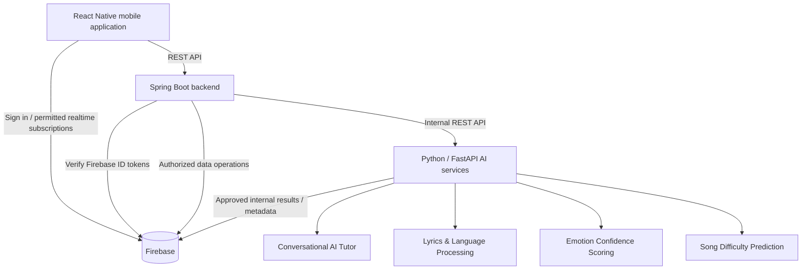

# 🎵 Naada — AI-Powered Music Learning Platform

**SLIIT Final Year Research Project | J26-IT-365 | 2026–2027**

> AI-Powered Music Learning Application Using Audio Analysis, Natural Language Processing (NLP), and Generative AI.

**Status:** Research and development. Features described here are research objectives and may not yet be implemented.

## Overview

Naada is a research-driven mobile music learning platform designed to support meaningful learning from songs. It brings together AI-based song lyric understanding, emotion analysis, adaptive song difficulty prediction, and a contextual conversational music tutor. The project targets learners aged approximately 11–26, including multilingual learners using Sinhala, Tamil, and English.

## Research components and ownership

| Student ID | Research component | Main responsibility |
| --- | --- | --- |
| IT23195516 | Conversational AI Music Tutor & Multimodal Inquiry Agent | Context-aware music question answering using RAG, acoustic metadata and lyrics; multilingual tutoring and chat synchronization |
| IT23308084 | AI-Powered Song Lyrics Understanding and Personalized Language Learning System | Song transcription, level-based lyric simplification, translation, vocabulary/idiom explanations and lyric interpretation |
| IT23324442 | AI-Driven Emotion Confidence Scoring Engine | Sinhala lyric-based multi-label emotion analysis, dominant emotion detection and calibrated confidence percentages |
| IT23155398 | AI-Based Song Difficulty Calculation Engine | Audio/lyric feature fusion, Random Forest/XGBoost regression, 0–100 difficulty prediction and optional personalization |

**Research supervision:** Ms. Akshi De Silva (Supervisor) and Ms. Aruni Premarathne (Co-supervisor).

## Technology stack

- **Mobile frontend:** React Native (JavaScript/TypeScript)
- **Application backend:** Java Spring Boot REST APIs
- **Shared platform services:** Firebase Authentication, Firebase database, and Firebase Cloud Storage (as configured)
- **AI inference / research services:** Python, FastAPI
- **Machine learning and NLP:** PyTorch, Hugging Face Transformers, Whisper, scikit-learn, XGBoost, Librosa, and appropriate LLM APIs (component-dependent)
- **Source control:** Git and GitHub

### High-level architecture



> **Authentication decision:** Firebase Authentication is the recommended shared identity provider. Spring Boot verifies Firebase ID tokens instead of independently issuing a second kind of JWT. The team should finalize authorization, database choice (Cloud Firestore vs Realtime Database), and endpoint contracts before integration.

## Repository organization

```text
naada-ai-music-learning-platform/
├── mobile/                              # React Native app
├── backend/                             # Java Spring Boot backend
├── ai-services/
│   ├── conversational-tutor/           # IT23195516
│   ├── lyrics-language-learning/        # IT23308084
│   ├── emotion-confidence-scoring/      # IT23324442
│   └── song-difficulty-calculation/     # IT23155398
├── firebase/                            # Security rules and local emulator configuration
├── shared/                              # API schemas, contracts, shared utilities
├── docs/                                # Research architecture and setup guides
├── datasets/                            # Documentation/sample data only; check licensing
├── .gitignore
└── README.md
```

Folders may initially contain only `.gitkeep` placeholders. React Native, Spring Boot, and Python project boilerplates should be generated and committed by the responsible developers.

## Getting started

### 1. Prerequisites

Install Git, Node.js and npm, Java JDK, an appropriate Spring Boot build tool (Maven or Gradle), Python 3, and the Android SDK / emulator for React Native development. Set up a Firebase project and request authorized access from the project administrator.

### 2. Clone the repository

```bash
git clone https://github.com/YOUR_GITHUB_USERNAME/naada-ai-music-learning-platform.git
cd naada-ai-music-learning-platform
```

Replace `YOUR_GITHUB_USERNAME` with the repository owner's GitHub username or organization.

### 3. Configure Firebase

1. Create or use the team's Firebase project in the [Firebase console](https://console.firebase.google.com/).
2. Enable Firebase Authentication and choose the sign-in providers.
3. Agree as a team whether the shared application database uses **Cloud Firestore** or **Realtime Database**, and configure Security Rules.
4. Configure Cloud Storage only if the project needs it and access permissions/licensing allow it.
5. Configure authorized Firebase client settings in the React Native app. Firebase client configuration is not itself an admin secret, but access must still be secured by Authentication and Security Rules.
6. Run the Spring Boot and Python services using **server-side credentials** or Application Default Credentials, never a service-account private key in the mobile app or Git repository.

Do **not** commit Firebase service account JSON files, `.env` files, API keys intended to be private, private datasets, or unlicensed music files.

### 4. Run the React Native app (after mobile scaffolding is added)

```bash
cd mobile
npm install
npm run android
```

Use the project's actual React Native CLI scripts; the commands above will work only after the `mobile/package.json` and Android project are configured.

### 5. Run the Spring Boot API (after backend scaffolding is added)

```bash
cd backend
./mvnw spring-boot:run
```

Windows PowerShell / CMD can use `mvnw.cmd spring-boot:run`. If the project uses Gradle rather than Maven, use the corresponding Gradle wrapper command.

### 6. Run a Python AI service (after its code and dependencies are added)

```bash
cd ai-services/emotion-confidence-scoring
python -m venv .venv
# Windows: .venv\Scripts\activate
# macOS/Linux: source .venv/bin/activate
pip install -r requirements.txt
uvicorn main:app --reload --port 8003
```

This example assumes the component creates `requirements.txt` and `main.py` exposing `app = FastAPI()`; those implementation files are not included in this repository starter.

## API and data integration conventions (proposed)

- Every AI component should expose an HTTP health check and a documented prediction/processing endpoint.
- Spring Boot acts as the public backend gateway; internal AI services should not be exposed publicly without authentication and rate limits.
- Share song identifiers, user identifiers, timestamp units, language codes, model versions and output JSON formats in `shared/` before integration.
- Long-running AI jobs (such as transcription) should return a job ID, and their status/results should be stored or retrieved asynchronously.
- Store only legally usable audio and lyrics; do not commit research participant personal information.

Illustrative endpoint naming, **not implemented by this starter**:

| Service | Proposed endpoint |
| --- | --- |
| Spring Boot API | `GET /api/health` |
| AI tutor | `POST /ai/tutor/ask` |
| Lyrics processing | `POST /ai/lyrics/process` |
| Emotion scoring | `POST /ai/emotions/predict` |
| Difficulty scoring | `POST /ai/difficulty/predict` |

## Collaboration workflow

Use the `main` branch for reviewed, integrated work. Each member works on an independent feature branch:

- `feature/tutor-it23195516`
- `feature/lyrics-it23308084`
- `feature/emotions-it23324442`
- `feature/difficulty-it23155398`

For a shared backend or mobile change, use descriptive branches such as `feature/firebase-auth` or `feature/mobile-song-player`.

```bash
git switch main
git pull origin main
git switch -c feature/emotions-it23324442
# edit files
git add .
git commit -m "feat(emotions): add emotion inference endpoint"
git push -u origin feature/emotions-it23324442
```

Open a pull request against `main`, request review, confirm tests pass, and merge only after approval. Do not commit directly to `main` once branch protections are configured.

## Security, responsible use, and research quality

- Never commit service-account JSON, credentials, access tokens, or secret `.env` values.
- Apply least-privilege Firebase Security Rules; test them with the Emulator Suite before deploying.
- Use Firebase ID token verification on protected backend routes.
- Use secure access to participant and student data, particularly where learners are under 18.
- Track model/data versions, evaluation splits, metrics, and annotation provenance for reproducibility.
- Respect copyright and license restrictions on music tracks, lyrics, datasets and pretrained models.

## Roadmap

- [ ] Bootstrap React Native mobile app
- [ ] Bootstrap Spring Boot backend and Firebase authentication
- [ ] Agree on shared database structure and API contracts
- [ ] Integrate lyrics-language service
- [ ] Integrate emotion-confidence scoring service
- [ ] Integrate song-difficulty service
- [ ] Integrate conversational tutor and contextual retrieval
- [ ] Add automated tests and CI checks
- [ ] Perform cross-component integration and user testing
- [ ] Document evaluation results and research outcomes

## Documentation

Start with `docs/SETUP.md` for repository setup and `docs/CONTRIBUTING.md` for the team's Git workflow. Research proposals, experimental details, architecture diagrams and approved artifacts can be kept in `docs/` with proper permissions.

## Research information

**Institution:** Sri Lanka Institute of Information Technology (SLIIT)  
**Project identifier:** J26-IT-365  
**Project title:** AI-Powered Music Learning Application Using Audio Analysis, NLP and Generative AI  
**Application name:** Naada  
**Academic period:** 2026–2027

---

_This is an academic research and development project. Listed functionality and metrics represent planned work unless explicitly marked as implemented._
